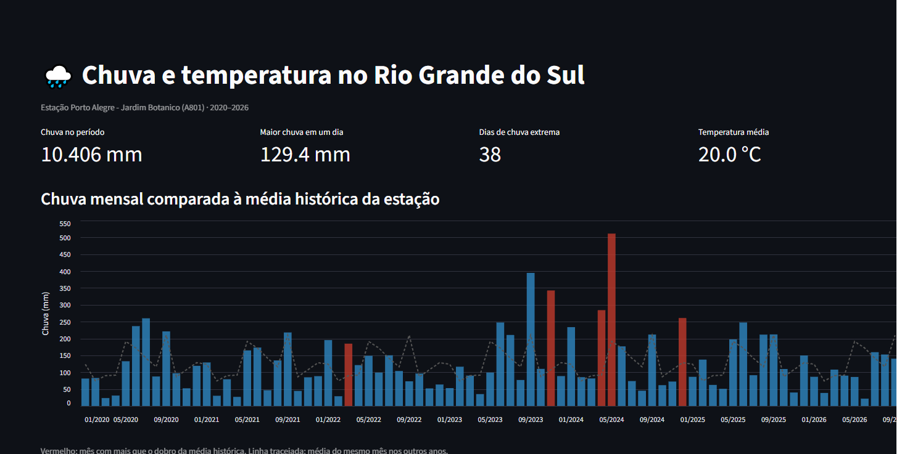
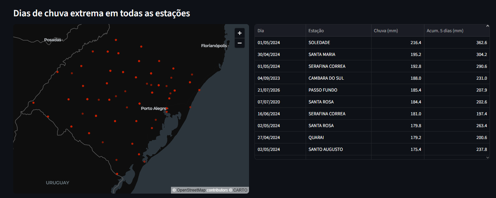
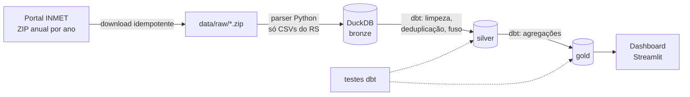
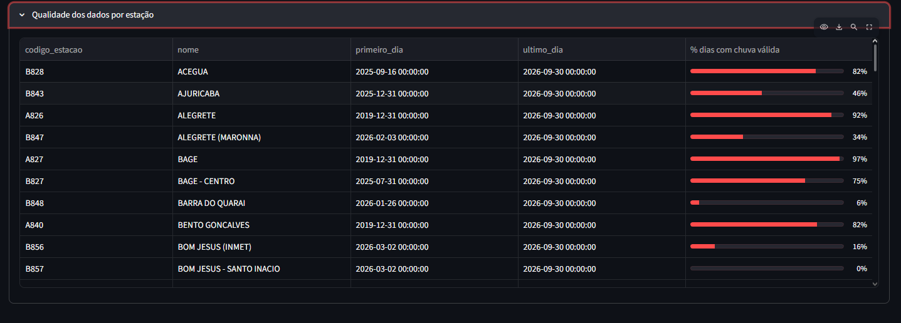

# 🌧️ Clima no RS: pipeline de dados do INMET

Pipeline de dados de ponta a ponta com as observações horárias das estações automáticas do **INMET** no **Rio Grande do Sul**: download dos arquivos públicos, ingestão em camadas (bronze, silver e gold), testes de qualidade com **dbt** e um **dashboard** para explorar chuva e temperatura.

A motivação é entender, com dados, eventos como as **enchentes de maio de 2024**. O dashboard mostra o quanto cada mês choveu em relação à média histórica da estação e quais dias passaram do limiar de chuva extrema em todo o estado.

O período padrão vai de **2020 a 2026**. O ano corrente vem parcial, porque o INMET atualiza o arquivo de 2026 ao longo do ano.


## O que os dados mostram



*Estação Porto Alegre (A801), 2020–2026. Em vermelho, os meses que choveram mais que o dobro da média histórica daquele mês.*

- **Maio de 2024 é o mês mais chuvoso da série em Porto Alegre, com mais de 500 mm**, mais que o dobro da média de maio. Abril de 2024 também aparece em vermelho: a chuva já vinha acima do normal antes da cheia.
- A estação teve **38 dias de chuva extrema** (50 mm ou mais) entre 2020 e 2026, e o pior dia somou 129,4 mm.



- No estado, os maiores volumes em um único dia se concentram entre **30 de abril e 2 de maio de 2024**: **216,4 mm em Soledade** (01/05), 195,2 mm em Santa Maria (30/04) e 192,8 mm em Serafina Corrêa (01/05).
- Em Soledade, o **acumulado de 5 dias chegou a 362,6 mm**. Isso mostra o que levou à cheia: não foi um temporal isolado, mas dias seguidos de chuva muito forte em várias regiões ao mesmo tempo.

## Arquitetura



| Camada | O que tem | Onde |
|---|---|---|
| **bronze** | Dados como o INMET publica, só tipados (datas, números, nulos) | `src/inmet_pipeline/` |
| **silver** | Uma linha por estação/hora, sem duplicatas, horário local, valores fisicamente impossíveis descartados | `dbt/models/staging/` |
| **gold** | Resumos diário e mensal, anomalia de chuva, eventos extremos e cobertura de cada estação | `dbt/models/marts/` |

## Stack

**Python** (requests, pandas) · **DuckDB** · **dbt** (dbt-duckdb) · **Streamlit** + Altair · **pytest** · **Docker** · **GitHub Actions**

O DuckDB foi escolhido por ser um banco analítico colunar que roda embutido, sem servidor: o projeto inteiro funciona com um único arquivo `.duckdb`. Os modelos dbt podem ser levados para PostgreSQL, BigQuery ou Databricks trocando apenas o adapter.

## Como rodar

Requisitos: Python 3.11 ou 3.12 e `make` (ou Docker).

```bash
python -m venv .venv && source .venv/bin/activate
make instalar
```

**Demonstração rápida, sem internet**, com os dados de exemplo de `tests/fixtures`:

```bash
make demo            # ingestão + dbt build (modelos e testes)
make dashboard-demo  # abre o dashboard em http://localhost:8501
```

**Com os dados reais do INMET:**

```bash
make pipeline                   # baixa 2020-2026, carrega e transforma
make pipeline ANOS="2025 2026"  # ou escolha os anos
make dashboard
```

**Com Docker:**

```bash
docker compose up --build     # roda o pipeline e depois sobe o dashboard
```

Também dá para rodar cada etapa separadamente:

```bash
python -m inmet_pipeline baixar --anos 2020 2021 2022 2023 2024 2025 2026
python -m inmet_pipeline ingerir --anos 2020 2021 2022 2023 2024 2025 2026
cd dbt && dbt build --profiles-dir .
```

## Modelos (gold)

| Modelo | Grão | Destaques |
|---|---|---|
| `fct_clima_diario` | estação × dia | chuva do dia, acumulado de 5 dias, temperatura média/máx/mín, umidade, rajada, flag de chuva extrema |
| `fct_clima_mensal` | estação × mês | chuva total, média histórica do mesmo mês e **anomalia (%)** |
| `fct_eventos_chuva_extrema` | dia com chuva ≥ 50 mm | ranking no ano, acumulado de 5 dias, localização |
| `dim_estacoes` | estação | localização e % de dias com dado de chuva válido |

## Qualidade dos dados

Os arquivos do INMET têm várias armadilhas, e boa parte do trabalho deste projeto é lidar com elas:

- **Formato que muda com o tempo.** Até 2018 a data vem como `2018-01-01` e a hora como `00:00`; depois, `2019/01/01` e `0000 UTC`. Os nomes das colunas também variam. O parser identifica as colunas por palavras-chave normalizadas (sem acento, maiúsculas), não pelo texto exato.
- **Vírgula decimal e `-9999`.** Valores como `,2` (0,2) e `-9999` (ausente) são convertidos para número ou `NULL`.
- **Encoding** latin-1 nos arquivos antigos e UTF-8 em alguns recentes.
- **Sensores com defeito.** Leituras fora de limites físicos (por exemplo, 99,9 °C) viram `NULL` na camada silver, e a coluna `teve_valor_descartado` registra quantas horas foram afetadas. Os limites ficam em `dbt_project.yml` (`vars.limites`).
- **Dias incompletos.** Se um dia tem menos de 18 horas válidas de chuva, o total não é calculado (fica `NULL`). Somar um dia pela metade faria um dia de temporal parecer um dia seco. O mesmo vale para meses com menos de 25 dias válidos na média histórica.

O dashboard tem um painel com a cobertura de cada estação:



As estações antigas (código A) têm a maior parte dos dias com chuva válida. As estações novas (código B), instaladas em 2025 e 2026, ainda têm muitas falhas de pluviômetro, e algumas ficam abaixo de 20%. Sem esse filtro, os dias sem medição entrariam como dias secos e puxariam as médias para baixo.

Testes dbt verificam unicidade (uma linha por estação/hora e por estação/dia), integridade referencial, não nulos e coerência física (máxima ≥ mínima, umidade entre 0 e 100, chuva não negativa).

## Decisões e limitações

- **Idempotência.** O download pula arquivos já baixados e íntegros, e grava em `.part` antes de renomear. A carga apaga e reinsere as linhas de cada arquivo dentro de uma transação, então rodar o pipeline duas vezes não duplica nada.
- **Fuso horário.** O INMET publica em UTC. A conversão usa UTC−3 fixo, que é correto desde 2019, quando o horário de verão acabou. Para anos anteriores, os meses de verão ficam deslocados em uma hora na divisão dos dias. Para totais diários de chuva o efeito é pequeno, mas está documentado aqui. Outro efeito da conversão: as três primeiras horas de cada arquivo anual (00h–02h UTC de 1º de janeiro) caem em 31/12 do ano anterior. Esse dia incompleto fica sem total de chuva (regra das 18 horas válidas) e o dashboard ignora meses sem nenhum dia válido.
- **Média histórica.** A anomalia compara com a média dos anos carregados (2020–2026 por padrão). Com poucos anos ela é uma referência fraca. O ideal seria usar as Normais Climatológicas do INMET (1991–2020).
- **Ano corrente parcial.** O arquivo de 2026 só tem os meses já publicados, e o mês mais recente costuma estar incompleto. Meses com menos de 25 dias válidos não entram na média histórica, então um mês pela metade não distorce a comparação. Para pegar os dados novos, rode `python -m inmet_pipeline baixar --anos 2026 --forcar`, que baixa o arquivo de novo mesmo que já exista.
- **Escopo.** Só estações automáticas, só RS (configurável com `INMET_UF`).

## Testes

```bash
make testes   # pytest: parser, leitura dos ZIPs, carga idempotente no DuckDB
make demo     # dbt build: modelos + testes de dados
```

A CI roda lint, pytest, confere se os dados de exemplo batem com o gerador (`scripts/gerar_dados_exemplo.py`) e executa o `dbt build` completo sobre eles.

## Estrutura

```
src/inmet_pipeline/   download, parser, leitura dos ZIPs, carga no DuckDB e CLI
dbt/models/staging/   camada silver
dbt/models/marts/     camada gold
dbt/tests/            testes de dados customizados
dashboard/app.py      dashboard Streamlit
scripts/              gerador dos dados de exemplo
tests/                testes Python e fixtures no formato do INMET
```

## Próximos passos

- Comparar a chuva com as **Normais Climatológicas** oficiais
- Orquestrar com **Airflow** ou **Dagster** e atualizar automaticamente o ano corrente
- Cruzar com as cotas do **Guaíba** (ANA) para relacionar chuva e cheia
- Publicar o dashboard no Streamlit Community Cloud

---

Dados: [INMET, Dados Históricos](https://portal.inmet.gov.br/dadoshistoricos). Projeto de estudo, sem vínculo com o INMET.
